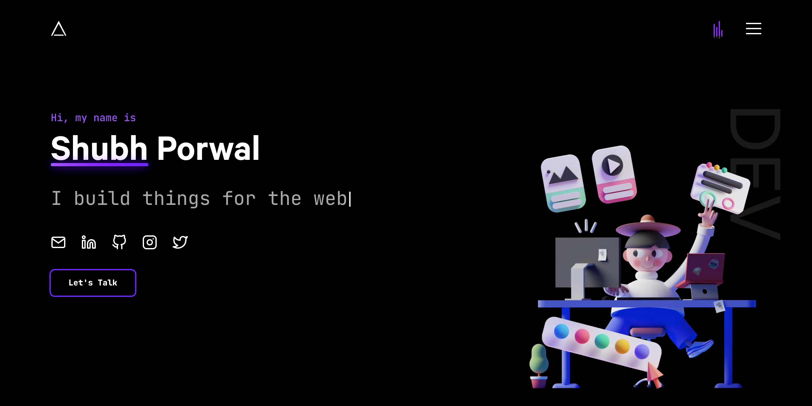

# 🚀 Shubham Dalvi | Modern Developer Portfolio

<div align="center">
  
  <br/><br/>
  
  [](https://nextjs.org/)
  [](https://reactjs.org/)
  [](https://greensock.com/)
  [](https://www.framer.com/motion/)
  [](https://tailwindcss.com/)
  [](./LICENSE.md)
  
  <br/>
  <h3>✨ <a href="https://shubham-portfolio-nine-eta.vercel.app/">Live Portfolio Website</a> ✨</h3>
  
  <p>
    An immersive, high-performance developer portfolio crafted with <b>Next.js</b>, <b>GSAP</b>, <b>Framer Motion</b>, <b>Vanilla Tilt</b>, and <b>Tailwind CSS</b>. Packed with rich animations, interactive sound design, scroll triggers, and sleek dark-mode aesthetics.
  </p>
</div>

---

## 📑 Table of Contents

1. [🌟 Overview & Highlights](#-overview--highlights)
2. [📄 Pages & Route Breakdown](#-pages--route-breakdown)
3. [🎨 Comprehensive Animation Breakdown (A to Z)](#-comprehensive-animation-breakdown-a-to-z)
   - [1. GSAP & ScrollTrigger Animations](#1-gsap--scrolltrigger-animations)
   - [2. Framer Motion Animations](#2-framer-motion-animations)
   - [3. 3D Tilt Animations (Vanilla Tilt)](#3-3d-tilt-animations-vanilla-tilt)
   - [4. Typewriter Animation (Typed.js)](#4-typewriter-animation-typedjs)
   - [5. CSS / SCSS Keyframe & Particle Animations](#5-css--scss-keyframe--particle-animations)
   - [6. Scroll Reveal Animations (React Reveal)](#6-scroll-reveal-animations-react-reveal)
4. [🔊 Audio Design & Sound Effects (Howler.js)](#-audio-design--sound-effects-howlerjs)
5. [🧩 Section-by-Section Architecture](#-section-by-section-architecture)
6. [🛠️ Tech Stack & Dependencies](#️-tech-stack--dependencies)
7. [📂 Project Directory Structure](#-project-directory-structure)
8. [🚀 Getting Started & Local Development](#-getting-started--local-development)
9. [⚙️ Environment Variables & Configuration](#️-environment-variables--configuration)
10. [👨‍💻 Author & Contact Information](#-author--contact-information)

---

## 🌟 Overview & Highlights

- **Dynamic Interactive Animations**: Built using a powerful mix of **GSAP ScrollTrigger** and **Framer Motion**, avoiding static UI and delivering a fluid experience.
- **Horizontal Scroll Pinning**: Desktop project showcase transforms vertical scrolling into a smooth horizontal reel using GSAP pinning.
- **Custom Dual Magnetic Cursor**: Dot + smooth follower ring with scale and blend mode transformations on hovering clickable items.
- **Sound Design**: Integrated background music player and tactile sound effects triggered by clicks, tab changes, menu toggles, and interactions.
- **Paper Airplane Button Animation**: Morphing SVG button animation on the "Resume" and "Send Message" buttons using GSAP keyframe physics.
- **Working Contact Form**: Integrated with **EmailJS** for instant email forwarding, client-side profanity filtering (**bad-words**), and dynamic toasts (**react-hot-toast**).
- **Express Custom Server**: Production-ready server with custom HTTP request logging middleware.

---

## 📄 Pages & Route Breakdown

The application uses the **Next.js Pages Router** architecture:

| Page / File | Route | Description |
| :--- | :--- | :--- |
| **`pages/index.js`** | `/` | **Main Portfolio Page** – The single-page experience containing all primary sections: Hero, About, Skills, Projects, Experience, Competitions, Collaboration, Contact, and Footer. |
| **`pages/404.js`** | `/404` | **Interactive Custom 404 Page** – Creative error page featuring GSAP-animated spilled milk liquid effect, a hovering character face, eye blinking timeline, custom cursor, and a home button. |
| **`pages/_app.js`** | N/A | **App Wrapper** – Injects global font variables (`Calibre`, `JetBrains Mono`), global SCSS styles, SEO meta tags, and Google Analytics 4 tracking (`@next/third-parties/google`). |
| **`pages/_document.js`** | N/A | **Document Structure** – Configures HTML root, Head meta headers, web app manifest, and favicons. |
| **`pages/api/hello.js`** | `/api/hello` | **API Route** – Boilerplate Next.js backend endpoint returning test JSON response. |

---

## 🎨 Comprehensive Animation Breakdown (A to Z)

Here is a full breakdown of **every animation library used, where it is implemented, and how it works**:

### 1. GSAP & ScrollTrigger Animations

> **Library:** `gsap` (v3.12.5) & `gsap/dist/ScrollTrigger`

GSAP is the primary animation driver across the portfolio:

- **Custom Dual Cursor (`components/Cursor/Cursor.js`)**:
  - Inner dot follows mouse coordinates rapidly (`duration: 0.1s`).
  - Outer ring follows with smooth trailing damping (`duration: 0.3s`).
  - Hovering elements with `.link` scales the cursor (inner scales down to `0.5`, follower expands to `3x`).

- **Hero Staggered Intro (`components/Hero/Hero.js`)**:
  - `gsap.timeline()` fades the container to `opacity: 1` and cascades elements marked with `.staggered-reveal` (`stagger: 0.5s`).

- **Paper Airplane Button Animation (`components/Hero/Hero.js` & `components/Contact/Contact.js`)**:
  - On clicking "Resume" or "Send", GSAP coordinates a multi-stage SVG morphing sequence.
  - Morphing keyframes reshape CSS variables: `--left-wing-first-x`, `--left-wing-second-y`, `--rotate`, and translate `--plane-y` to `-300px` to launch the airplane off the screen.
  - On flight completion, a success state triggers, resetting back to the button via `fromTo()` after a timeout.

- **Scroll-Controlled Narrative Text (`components/About/About1.js` & `About2.js`)**:
  - ScrollTrigger scrubs text opacity from `0.2` to `1` as the user scrolls into view.
  - Infinite continuous text shimmer animation using GSAP repeating `backgroundPosition: "200% 50%"` on gradient spans.
  - `About2.js` scrubs the gradient background fill across text (`backgroundPositionX: "100%"`).

- **Interactive Skills Section (`components/Skills/Skills.js`)**:
  - ScrollTrigger staggered cascade on icons.
  - Interactive mouse hover triggers `gsap.to(icon, { y: -8, scale: 1.15, ease: "power2.out" })` and smooth return on leave.

- **Horizontal Pinned Projects Showcase (`components/Projects/Projects.js`)**:
  - On desktop, `ScrollTrigger.create()` pins the section (`pin: true, scrub: 0`).
  - Vertically scrolling moves the container horizontally across `x: window.innerWidth - elementWidth`, creating a horizontal gallery effect.

- **Dual Sliding Marquee Banners (`components/Collaboration/Collaboration.js`)**:
  - Dual text streams move in opposing directions (`ui-left` travels left, `ui-right` travels right) tied to scroll depth via `scrub: 1`.

- **Custom 404 Page Animations (`pages/404.js`)**:
  - **Spilled Milk Expansion**: Smooth liquid scaling `gsap.to(milkSpill, { scale: 1.25, duration: 30 })`.
  - **Floating Face**: Continuous floating bobbing motion `gsap.to(face, { yPercent: -15, yoyo: true, repeat: -1 })`.
  - **Blinking Eyes**: Looping timeline closing and opening eyelids every 4 seconds (`gsap.timeline({ repeat: -1, repeatDelay: 4 })`).

---

### 2. Framer Motion Animations

> **Library:** `framer-motion` (v11.1.9)

Framer Motion handles physics-based UI transitions and card decks:

- **Spring-Loaded Tab Indicator (`components/Work/Tabs/Tabs.js` & `components/Competitions/Tabs/Tabs.js`)**:
  - Uses `<motion.div layoutId="clickedbutton" />` with spring physics (`bounce: 0.3, duration: 0.7`) to glide the active pill under selected tabs.

- **3D Card Deck Stacking & Hover Lift (`Tabs.js`)**:
  - Tab cards stack with calculated 3D scale reduction (`scale: 1 - index * 0.1`) and depth stacking (`zIndex: -index`).
  - Hovering the tab container pushes background cards upward (`top: index * -50`), creating a deck-reveal effect.

- **Sticky Scroll Experience & Hackathon Log (`components/Work/StickyScroll/` & `components/Competitions/StickyScroll/`)**:
  - Utilizes `useScroll({ container })` and `useMotionValueEvent` to monitor internal scroll progress.
  - Active milestone dynamically glows (`opacity: 1`), while inactive items dim (`opacity: 0.3`).
  - Right-side company/hackathon logo panel slides smoothly (`y: activeCard * -400`) with ease transitions.

---

### 3. 3D Tilt Animations (Vanilla Tilt)

> **Library:** `vanilla-tilt` (v1.8.1)

- **Project Card Parallax Hover (`components/Projects/ProjectTile/ProjectTile.js`)**:
  - Mouse movement over project cards generates real-time 3D rotation (`max: 10deg`, `speed: 400ms`).
  - Dynamic glare reflection enabled (`glare: true, max-glare: 0.2`).
  - Internal typography and badges float in 3D space using CSS `transform: translateZ(3rem)` and `transform: translateZ(0.8rem)`.

---

### 4. Typewriter Animation (Typed.js)

> **Library:** `typed.js` (v2.1.0)

- **Hero Dynamic Heading (`components/Hero/Hero.js`)**:
  - Loops continuously through predefined strings in `constants.js`:
    - *"Full Stack Developer"*
    - *"Turning ideas into websites"*
    - *"Building scalable solutions"*
    - *"Crafting modern apps"*
    - *"Creating engaging interfaces"*
  - Features configurable `typeSpeed: 50`, `backSpeed: 50`, `backDelay: 8000ms`, and custom blinking cursor styling.

---

### 5. CSS / SCSS Keyframe & Particle Animations

- **Spaceship Preloader (`components/Loader/Loader.module.scss`)**:
  - Custom CSS loader running during initial site load (2.6s).
  - High-speed spaceship jitter: `@keyframes speeder`.
  - Passing light speed streaks: `@keyframes fazer1` to `@keyframes fazer4`.
  - Loading bar animation: `@keyframes load` and `@keyframes fadeAppear`.

- **Falling Meteor Shower (`components/Footer/Meteors/Meteors.js` & `tailwind.config.js`)**:
  - Procedurally generated meteors positioned randomly across screen width.
  - Tailwind animation `animate-meteor` with keyframes translating trails 500px diagonally at 215 degrees with opacity fading.

- **Reading Progress Bar (`components/ProgressIndicator/ProgressIndicator.js`)**:
  - Real-time scroll listener modifies CSS `transform: scaleX(scrolled)` across top viewport edge.

- **Animated Audio Equalizer (`components/Header/SoundBar/SoundBar.js`)**:
  - Pulsing bars animate while background music plays.

- **Morphing Hamburger Menu (`styles/globals.scss`)**:
  - Hamburger bars morph into an 'X' icon upon checkbox toggle.

---

### 6. Scroll Reveal Animations (React Reveal)

> **Library:** `react-reveal` (v1.2.2)

- Smooth bottom fade-in entrance for footer cards and contact elements (`<Fade bottom distance="4rem">`).

---

## 🔊 Audio Design & Sound Effects (Howler.js)

Audio feedback is handled through **Howler.js** (`howler` v2.2.4) and HTML5 Audio:

| Sound File | Trigger Event | Component | Description |
| :--- | :--- | :--- | :--- |
| **`song.mp3`** | SoundBar Click | `Header/SoundBar` | Background ambient soundtrack with play/pause toggle. |
| **`multi-pop.mp3`** | Menu Toggle | `Header/Header` | Tactile pop sound when opening navigation overlay. |
| **`mouse-click.mp3`** | Tab Switch | `Work/Tabs` & `Competitions/Tabs` | Click sound on switching experience/hackathon tabs. |
| **`glug-a.mp3`** | Heart Click | `Footer/Footer` | Interactive audio with dynamic pitch acceleration (`playbackRate += 0.1` on each click). |

---

## 🧩 Section-by-Section Architecture

```
[ Preloader (Speeder & Particles) ]
               │
               ▼
┌────────────────────────────────────────────────────────┐
│ Header (Logo + Audio SoundBar + Hamburger Menu)        │
├────────────────────────────────────────────────────────┤
│ Reading Progress Indicator (Fixed Top Bar)             │
├────────────────────────────────────────────────────────┤
│ Custom Dual Cursor (Dot + Trailing Ring)               │
├────────────────────────────────────────────────────────┤
│ 1. Hero Section                                        │
│    ├── Typed.js Developer Titles                       │
│    ├── Paper Airplane Launch Resume Button             │
│    └── Social Profiles & Floating Avatar               │
├────────────────────────────────────────────────────────┤
│ 2. About Part 1 (Scroll Scrub & Shimmering Gradients)  │
├────────────────────────────────────────────────────────┤
│ 3. Skills Matrix (Icons + Hover Physics + Tooltips)    │
├────────────────────────────────────────────────────────┤
│ 4. About Part 2 (Text Highlight Gradient Scrub)        │
├────────────────────────────────────────────────────────┤
│ 5. Projects Showcase (Horizontal Scroll Reel + 3D Tilt)│
├────────────────────────────────────────────────────────┤
│ 6. Experience (Framer Spring Tabs + StickyScroll Log)  │
├────────────────────────────────────────────────────────┤
│ 7. Hackathons & Competitions (Interactive Tabs & Log)  │
├────────────────────────────────────────────────────────┤
│ 8. Collaboration Ticker (Opposing Dual Marquees)       │
├────────────────────────────────────────────────────────┤
│ 9. Contact Section                                     │
│    ├── EmailJS Submission Pipeline                     │
│    ├── Profanity Filter (bad-words)                    │
│    └── Paper Airplane Send Animation                   │
├────────────────────────────────────────────────────────┤
│ 10. Footer (Meteor Shower + Sound FX + Quick Links)    │
└────────────────────────────────────────────────────────┘
```

---

## 🛠️ Tech Stack & Dependencies

### Core Frameworks

- **[Next.js](https://nextjs.org/)** (v14.2.30) - React framework (Pages router, SSR, static generation, image optimization)
- **[React](https://reactjs.org/)** (v18.2.0) - UI library
- **[Express](https://expressjs.com/)** (v4.22.3) - Custom backend server with access logging

### Styling & Design

- **[Tailwind CSS](https://tailwindcss.com/)** (v3.3.3) - Utility-first styling with custom theme tokens
- **[Sass / SCSS](https://sass-lang.com/)** (v1.77.1) - Scoped modular styling
- **[Calibre & JetBrains Mono](https://fonts.google.com/)** - Custom font pairings

### Animations & Interactions

- **[GSAP](https://greensock.com/)** (v3.12.5) + **ScrollTrigger** - Timelines, pinning, scrubbing, cursor physics
- **[Framer Motion](https://www.framer.com/motion/)** (v11.1.9) - Layout springs, card deck stacking, sticky scroll
- **[Vanilla Tilt](https://micku7zu.github.io/vanilla-tilt.js/)** (v1.8.1) - 3D card tilt & glare
- **[Typed.js](https://mattboldt.com/demos/typed-js/)** (v2.1.0) - Typewriter effect
- **[React Reveal](https://www.react-reveal.com/)** (v1.2.2) - Scroll fade reveals

### Audio, Notifications & Services

- **[Howler.js](https://howlerjs.com/)** (v2.2.4) - Audio playback engine
- **[@emailjs/browser](https://www.emailjs.com/)** (v4.3.3) - Client-side email sending
- **[bad-words](https://www.npmjs.com/package/bad-words)** (v3.0.4) - Form profanity sanitization
- **[react-hot-toast](https://react-hot-toast.com/)** (v2.4.1) - Lightweight toast notifications
- **[@next/third-parties](https://nextjs.org/docs/app/building-your-application/optimizing/third-parties)** - Google Analytics 4 integration

---

## 📂 Project Directory Structure

```
devfolio-main/
├── components/
│   ├── About/                   # About1 (text scrub) & About2 (gradient highlight)
│   ├── Achievements/            # Winner showcases & milestones
│   ├── Button/                  # Primary & secondary button components
│   ├── Collaboration/           # Dual-direction ticker marquee with scrub
│   ├── Competitions/            # Hackathons tabs & sticky scroll view
│   ├── Contact/                 # Contact form, mailer.js, paper airplane animation
│   ├── Cursor/                  # GSAP dual-cursor follower
│   ├── Footer/                  # Footer with Meteors, sound triggers, social links
│   ├── Header/                  # Top navbar, soundbar audio toggle, full-screen menu
│   ├── Hero/                    # Introduction, Typed.js, resume flyer, profile card
│   ├── Loader/                  # Custom CSS spaceship preloader
│   ├── Meta/                    # Dynamic SEO & OpenGraph tags
│   ├── Profiles/                # Social links icons list
│   ├── ProgressIndicator/       # Top scroll reading progress bar
│   ├── Projects/                # Pinned horizontal projects container & 3D tilt tiles
│   ├── Skills/                  # Categorized skills matrix with GSAP hover physics
│   └── Work/                    # Work experience tabs & StickyScroll timeline
├── constants.js                 # Central data file (projects, work, links, skills)
├── logs/                        # Server access logs generated by server.js
├── pages/
│   ├── _app.js                  # App wrapper with fonts and analytics
│   ├── _document.js             # HTML document configuration
│   ├── 404.js                   # Custom 404 error page with GSAP liquid/eye animations
│   ├── api/                     # Next.js backend API routes
│   └── index.js                 # Single-page portfolio root
├── public/
│   ├── favicons/                # Web favicons
│   ├── fonts/                   # Calibre & JetBrains Mono font files
│   ├── projects/                # Project thumbnails and blurred placeholders
│   ├── profile/                 # Profile avatars
│   ├── skills/                  # Technology logos
│   └── sounds/                  # MP3 and WAV audio assets
├── styles/
│   └── globals.scss             # Global styling, resets, and menu animations
├── utils/
│   ├── cn.js                    # Class name merger helper (clsx + tailwind-merge)
│   └── log.js                   # Console ASCII art welcome banner
├── server.js                    # Express custom server with HTTP logging
├── tailwind.config.js           # Tailwind configuration (custom colors, fonts, meteor keyframes)
└── package.json                 # Project dependencies and run scripts
```

---

## 🚀 Getting Started & Local Development

### Prerequisites

- **Node.js** (v18.x or later recommended)
- **Yarn** or **npm**

### Installation

1. **Clone the repository:**
   ```bash
   git clone https://github.com/Shubham23593/Factorial.git
   cd Factorial
   ```

2. **Install project dependencies:**
   ```bash
   yarn install
   # or
   npm install
   ```

3. **Start the local development server:**
   ```bash
   yarn dev
   # or
   npm run dev
   ```

4. **View in browser:**
   Open [http://localhost:3000](http://localhost:3000) to view your portfolio.

### Building for Production

To create an optimized production build:

```bash
# Build production bundle
yarn build

# Run production server with custom logging
yarn start
```

---

## ⚙️ Environment Variables & Configuration

Create a `.env.local` file in the root directory for personal configurations:

```env
# Google Analytics
NEXT_PUBLIC_GTAG=G-5HCTL2TJ5W

# Server Configuration (optional)
PORT=3000
NODE_ENV=development
```

EmailJS service IDs and credentials are configured in [components/Contact/mailer.js](file:///c:/shubham%20dalvi%20project/portfolio/devfolio-main/components/Contact/mailer.js).

---

## 👨‍💻 Author & Contact Information

**Shubham Dalvi**  
*Full Stack Developer | Frontend Engineer*

- 🌐 **Live Website**: [shubham-portfolio-nine-eta.vercel.app](https://shubham-portfolio-nine-eta.vercel.app/)
- 💼 **LinkedIn**: [linkedin.com/in/shubham-dalvi-7586b0342](https://www.linkedin.com/in/shubham-dalvi-7586b0342/)
- 🐙 **GitHub**: [github.com/Shubham23593](https://github.com/Shubham23593)
- 📧 **Email**: [shubhamdalvi775@gmail.com](mailto:shubhamdalvi775@gmail.com)

---

<div align="center">
  <sub>Built with ❤️ by Shubham Dalvi. Star ⭐ this repo if you find it helpful!</sub>
</div>
